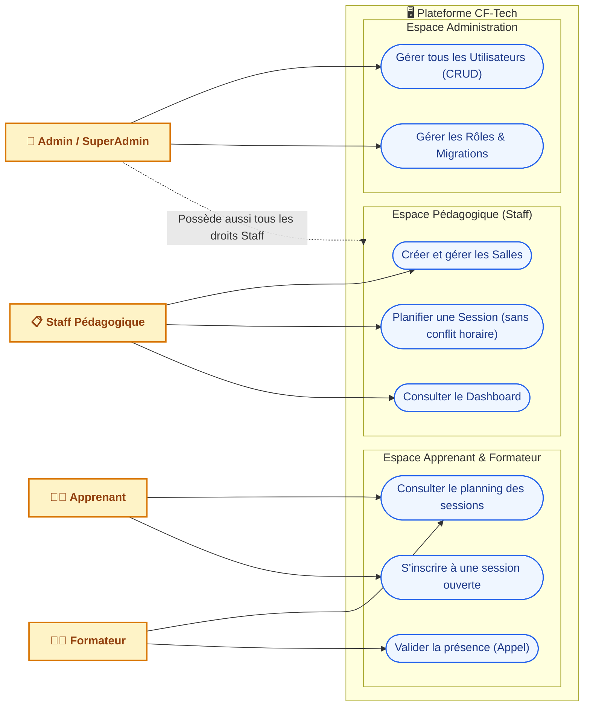
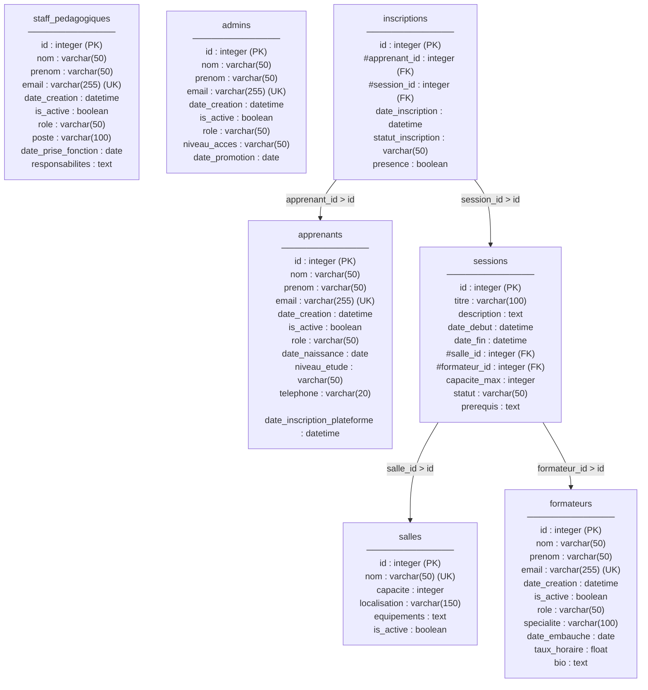

# 🎓 CF-Tech ERP — Base de Données & ORM

**Projet Data Engineering réalisé par Oussama, Xavier & Romain**


---

## 🎯 Objectif du Projet
Remplacer la gestion manuelle (Excel / ancien ERP) du centre de formation **CF-Tech** par une base relationnelle centralisée en Python :
- **Modélisation ORM (`SQLModel`) :** 7 tables avec héritage (`UserBase`) pour gérer les *Apprenants, Formateurs, Staff, Admins, Salles, Sessions* et *Inscriptions*.
- **Validation stricte (`Pydantic`) :** Emails valides (`EmailStr`), âge $\ge$ 16 ans, téléphone (Regex), taux horaire $\ge 0$ et dates cohérentes (`date_debut < date_fin`).
- **Règles Métier (`auth/`) :** Anti-chevauchement horaire des salles et apprenants (`is_salle_disponible`), respect des capacités max et gestion des droits (`check_permission`).
- **Migrations (`Alembic`) :** Évolution versionnée du schéma (tables initiales $\rightarrow$ statut session $\rightarrow$ équipements JSON salle $\rightarrow$ rôle `SUPERADMIN`).
- **Interface Web (`Flask`) :** Dashboard, gestion CRUD des utilisateurs, planification des sessions et inscriptions.

---

## 🚀 Installation & Lancement

```bash
# 1. Activer l'environnement virtuel et installer les paquets
python3 -m venv .venv
source .venv/bin/activate
pip install -r requirements.txt

# 2. Appliquer les migrations Alembic
alembic upgrade head

# 3. Lancer l'application Flask (http://127.0.0.1:5000)
python -m app.app_flask
```

---

## 🗂️ Structure du Projet

```text
brief_bdd_orm/
├── alembic/                  # Scripts de migrations (versions/) et configuration env.py
├── app/
│   ├── auth/                 # permissions.py (droits) & validators.py (anti-chevauchement)
│   ├── models/               # Tables SQLModel (users.py, salles.py, sessions.py, inscriptions.py)
│   ├── schemas/              # Validations Pydantic (users_schemas.py, sessions_schemas.py...)
│   ├── templates/            # Pages HTML Bootstrap (index.html, users.html, sessions.html)
│   ├── app_flask.py          # Serveur Web Flask
│   └── database.py           # Connexion SQLModel (Engine & Session)
├── .env                      # DATABASE_URL="sqlite:///./cftech.db"
└── requirements.txt          # Dépendances Python
```

---

## 📐 Schémas d'Architecture (UML & Merise)

### 1. Schéma des Cas d'Utilisation



### 2. MCD (Modèle Conceptuel de Données)


### 3. MLD (Modèle Logique de Données)

