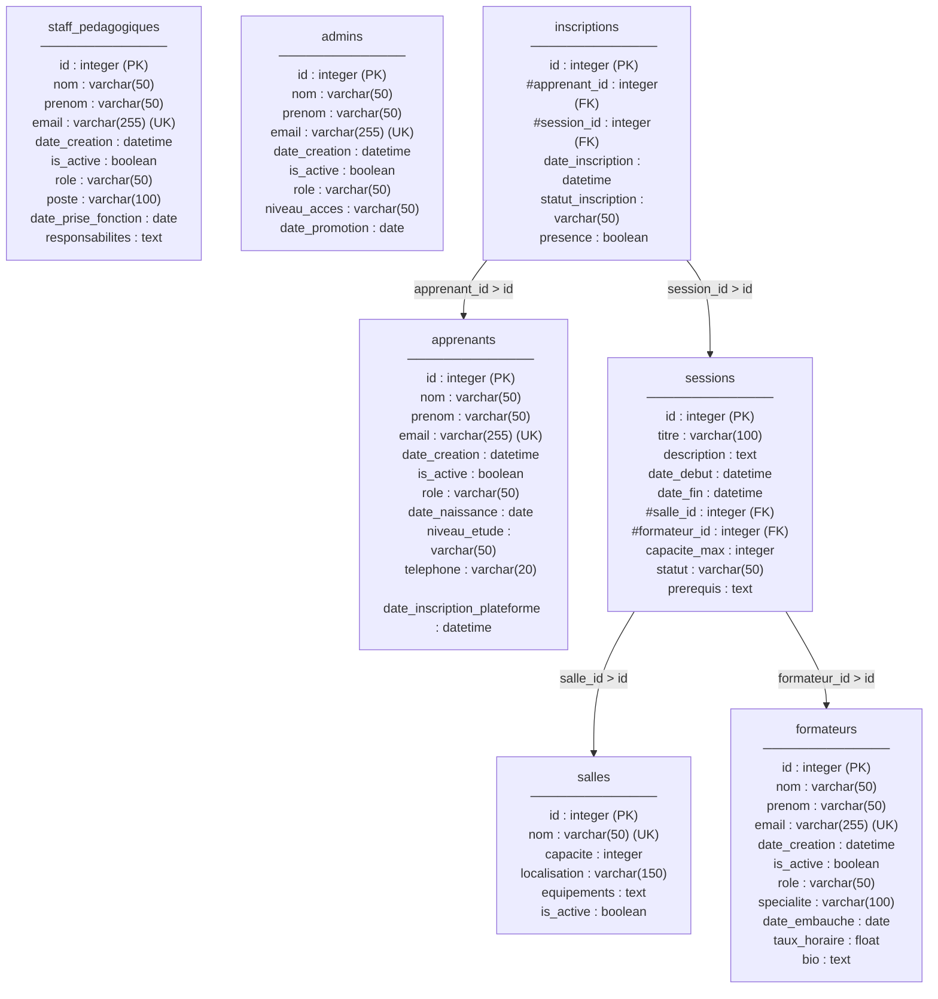

# 🎓 CF-Tech ERP — Gestion de Centre de Formation (ORM & Validation)

**Projet Data Engineering — Création d'une base de données relationnelle pilotée par un ORM**  
**Équipe :** Oussama, Xavier & Romain

---

## 📌 1. Contexte & Objectifs du Projet

Le centre de formation **CF-Tech** dispense des cours et ateliers sur les technologies numériques. Jusqu'à présent, les informations concernant les sessions de cours, les salles, les formateurs et les apprenants étaient gérées manuellement à l'aide de fichiers Excel dispersés et d'un ERP vieillissant. Ce fonctionnement artisanal entraînait de nombreuses erreurs de saisie, des doublons de comptes et des conflits d'emploi du temps lors de la réservation des salles.

L'objectif de ce projet est de concevoir et déployer une **base de données relationnelle robuste, centralisée et sécurisée**, entièrement pilotée en Python :

- **Modélisation Orientée Objet (SQLModel & SQLAlchemy 2.0) :** Représentation fidèle des entités du centre de formation à travers 7 tables relationnelles. Les champs communs aux utilisateurs (`nom`, `prenom`, `email`, `date_creation`, `is_active`) sont centralisés dans une classe mère abstraite `UserBase`, dont héritent les 4 tables spécialisées (`Apprenant`, `Formateur`, `StaffPedagogique` et `Admin`).
- **Validation Stricte à l'Entrée (Pydantic v2) :** Avant toute insertion en base de données, les données saisies passent par des schémas de validation (`schemas/`) chargés de garantir la qualité des informations : vérification du format des adresses email (`EmailStr`), contrôle de l'âge minimum des apprenants (au moins 16 ans révolus), validation par expression régulière des numéros de téléphone, contrôle des taux horaires positifs et cohérence chronologique des sessions (`date_debut < date_fin`).
- **Règles Métier & Sécurité (`auth/`) :** Implémentation des contrôles métiers critiques directement en base de données : vérification de la disponibilité des salles et des créneaux horaires pour empêcher tout chevauchement (`is_salle_disponible`), respect de la capacité d'accueil maximale des salles et des sessions, et gestion des droits d'accès par rôle (`check_permission`).
- **Gestion des Migrations (Alembic) :** Suivi versionné de l'évolution du schéma de la base de données permettant d'ajouter de nouvelles colonnes ou de nouveaux rôles en production sans jamais interrompre le service ni perdre les données existantes.
- **Application Graphique Web (Flask) :** Développement d'une interface web permettant aux équipes administratives et pédagogiques de visualiser les indicateurs clés sur un tableau de bord (Dashboard) et de gérer simplement les utilisateurs, les salles, la planification des sessions et les inscriptions.

---

## 🗂️ 2. Architecture du Dépôt

Le projet suit une séparation stricte des responsabilités entre la structure des tables (`models`), la validation des formulaires (`schemas`), les règles de gestion (`auth`) et l'interface web (`templates`) :

```text
brief_bdd_orm/
├── alembic/                      # Historique et configuration des migrations Alembic
│   ├── versions/                 # Scripts des migrations successives (v1 à v4)
│   ├── env.py                    # Configuration reliée à SQLModel.metadata
│   └── script.py.mako            # Modèle de génération incluant sqlmodel
├── app/
│   ├── auth/                     # Logique métier, sécurité et règles de gestion
│   │   ├── permissions.py        # Contrôle des droits d'accès (check_permission)
│   │   └── validators.py         # Anti-chevauchement horaire (is_salle_disponible) & inscriptions
│   ├── models/                   # Modèles de tables relationnelles (SQLModel table=True)
│   │   ├── users.py              # UserBase + Apprenant, Formateur, StaffPedagogique, Admin
│   │   ├── salles.py             # Modèle Salle (avec équipements au format JSON)
│   │   ├── sessions.py           # Modèle SessionFormation
│   │   └── inscriptions.py       # Modèle Inscription (avec contrainte d'unicité)
│   ├── schemas/                  # Schémas de validation à l'entrée (Pydantic BaseModel)
│   │   ├── users_schemas.py      # Validations âge >= 16 ans, EmailStr, regex téléphone, taux >= 0
│   │   ├── sessions_schemas.py   # Validation date_debut < date_fin
│   │   └── inscriptions_schemas.py
│   ├── templates/                # Vues HTML / Bootstrap (Jinja2) pour Flask
│   │   ├── index.html            # Tableau de bord (statistiques globales)
│   │   ├── users.html            # Gestion des Apprenants, Formateurs et Admins
│   │   └── sessions.html         # Gestion des Salles, Sessions et Inscriptions
│   ├── app_flask.py              # Serveur Web Flask et routes principales
│   └── database.py               # Configuration du moteur SQLModel (Engine) et des Sessions
├── .env                          # Variables d'environnement (DATABASE_URL)
├── alembic.ini                   # Fichier de configuration Alembic
├── requirements.txt              # Liste des dépendances Python du projet
└── README.md                     # Documentation générale du projet
```

---

## ⚙️ 3. Installation & Démarrage

### 3.1. Préparation de l'environnement Python
Clonez le dépôt puis créez un environnement virtuel isolé afin d'y installer toutes les bibliothèques nécessaires (`sqlmodel`, `sqlalchemy`, `pydantic`, `email-validator`, `alembic`, `flask`, `python-dotenv`) :

```bash
# Créer et activer l'environnement virtuel
python3 -m venv .venv
source .venv/bin/activate

# Installer les dépendances
pip install -r requirements.txt
```

### 3.2. Configuration de la base de données (`.env`)
Le projet utilise un fichier `.env` à la racine pour définir l'URL de connexion à la base de données SQLite :

```env
DATABASE_URL="sqlite:///./cftech.db"
```

### 3.3. Lancement de l'application Web Flask
Pour démarrer le serveur de développement et initialiser la base de données :

```bash
python -m app.app_flask
```
L'interface graphique est alors accessible localement dans le navigateur à l'adresse `127.0.0.1:5000`.

---

## ⏱️ 4. Gestion des Migrations avec Alembic

Conformément au cahier des charges, la structure de la base de données n'a pas été figée dès le départ mais a évolué progressivement à travers plusieurs migrations Alembic :

1. **Migration initiale (v1) :** Création des tables initiales du schéma relationnel.
2. **Migration v2 :** Ajout du champ `statut` (`OPEN`, `CLOSED`, `ARCHIVED`) sur la table `sessions` pour contrôler l'ouverture des inscriptions.
3. **Migration v3 :** Refonte de la table `salles` afin d'y intégrer un champ `equipements` au format JSON permettant de détailler le matériel disponible (vidéoprojecteur, tableau, postes informatiques).
4. **Migration v4 :** Évolution de la gestion des droits administrateurs avec l'introduction du niveau d'accès `SUPERADMIN`.

### Commandes utilisées pour administrer les migrations :
```bash
# Générer automatiquement un script de migration après modification d'un modèle
alembic revision --autogenerate -m "description_de_la_modification"

# Appliquer les migrations en attente sur la base de données
alembic upgrade head

# Afficher l'historique complet des versions du schéma
alembic history --verbose
```

---

## 🛡️ 5. Synthèse des Validations & Règles Métier

| Catégorie | Règle Implémentée | Emplacement |
| :--- | :--- | :--- |
| **Validation Pydantic** | Vérification de la validité de l'email (`EmailStr`), de l'unicité du compte et de la longueur des noms/prénoms (1 à 50 caractères). | `app/schemas/users_schemas.py` |
| **Validation Pydantic** | Calcul automatique de l'âge à partir de `date_naissance` : rejet immédiat si l'apprenant a moins de **16 ans**. | `app/schemas/users_schemas.py` |
| **Validation Pydantic** | Contrôle du numéro de téléphone par expression régulière (`^0[1-9]\d{8}$`). | `app/schemas/users_schemas.py` |
| **Validation Pydantic** | Contrôle des formateurs : `taux_horaire >= 0` et `date_embauche` strictement passée. | `app/schemas/users_schemas.py` |
| **Validation Pydantic** | Validation croisée des dates d'une session (`@model_validator`) : `date_fin` doit être postérieure à `date_debut`. | `app/schemas/sessions_schemas.py` |
| **Règle Métier (SQL)** | **Disponibilité des salles (`is_salle_disponible`) :** Interdiction de planifier deux sessions qui se chevauchent dans la même salle sur le même créneau horaire. | `app/auth/validators.py` |
| **Règle Métier (SQL)** | **Capacité d'accueil :** Vérification que `capacite_max` de la session ne dépasse pas la capacité physique de la salle, et blocage des inscriptions lorsque la session est pleine. | `app/auth/validators.py` |
| **Règle Métier (SQL)** | **Emploi du temps Apprenant :** Empêche un apprenant de s'inscrire deux fois à la même session (contrainte d'unicité) ou à deux cours qui se chevauchent. | `app/auth/validators.py` |
| **Contrôle d'Accès** | Fonction `check_permission(user, action)` s'appuyant sur la propriété dynamique `@property def role` définie par héritage. | `app/auth/permissions.py` |

---

## 📐 6. Schémas de Conception (UML & Merise)

### 6.1. Schéma des Cas d'Utilisation


---

### 6.2. Modèle Conceptuel de Données (MCD)


---

### 6.3. Modèle Logique de Données (MLD)



---

## 👥 7. Collaboration & Organisation Git

Ce projet a été développé en trinôme par **Oussama, Xavier et Romain**. Le travail a été réparti sur des branches Git dédiées par fonctionnalité (`models`, `schemas`, `migrations`, `feature/webdev`), permettant de travailler en parallèle, d'effectuer des revues de code croisées et de fusionner proprement chaque brique vers la branche principale.