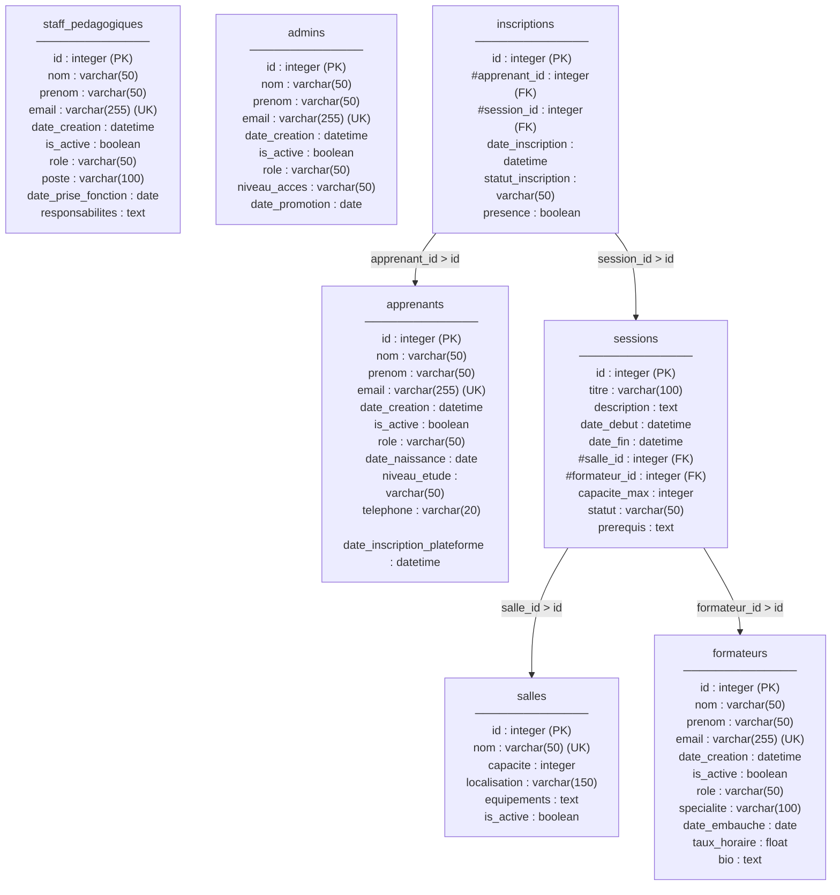
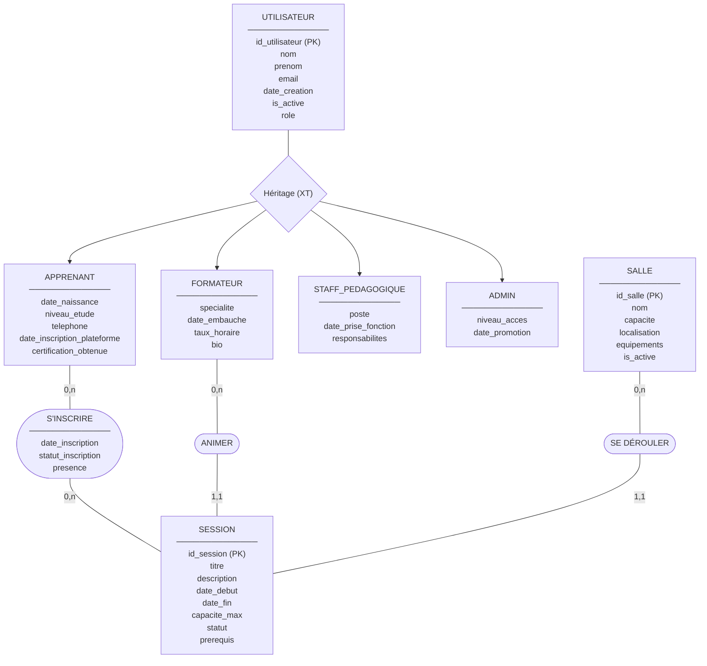

# brief_bdd_orm
Brief base de donnée en ORM de Oussama Xavier et Romain

MLD

MCD

from sqlmodel import Session, select, func
from models.inscriptions import Inscription, StatutInscriptionEnum
from models.sessions import SessionFormation
from schemas.inscriptions_schemas import InscriptionCreate

class ChevauchementSessionError(Exception):
    """L'apprenant est déjà inscrit à une session qui se chevauche."""

class SessionPleineError(Exception):
    """La session a atteint sa capacité maximale."""

def inscrire_apprenant(db: Session, data: InscriptionCreate) -> Inscription:
    nouvelle = db.get(SessionFormation, data.session_id)
    if nouvelle is None:
        raise ValueError(f"Session {data.session_id} introuvable")

    # Capa
    nb_inscrits = db.exec(
        select(func.count())
        .select_from(Inscription)
        .where(
            Inscription.session_id == data.session_id,
            Inscription.statut_inscription == StatutInscriptionEnum.ENREGISTRE,
        )
    ).one()

    if nb_inscrits >= nouvelle.capacite_max:
        raise SessionPleineError(
            f"Session « {nouvelle.titre} » pleine ({nb_inscrits}/{nouvelle.capacite_max})"
        )

    # Chevauch
    conflit = db.exec(
        select(SessionFormation)
        .join(Inscription, Inscription.session_id == SessionFormation.id)
        .where(
            Inscription.apprenant_id == data.apprenant_id,
            Inscription.statut_inscription == StatutInscriptionEnum.ENREGISTRE,
            SessionFormation.date_debut < nouvelle.date_fin,
            SessionFormation.date_fin > nouvelle.date_debut,
        )
    ).first()

    if conflit:
        raise ChevauchementSessionError(
            f"Chevauchement avec la session « {conflit.titre} »"
        )

    # Enregistrement
    inscription = Inscription(apprenant_id=data.apprenant_id, session_id=data.session_id)
    db.add(inscription)
    db.commit()
    db.refresh(inscription)
    return inscription